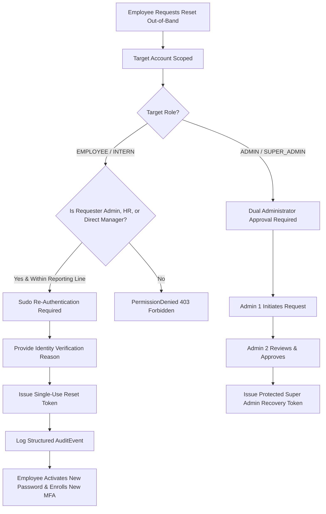

# Salow Workspace — Account Recovery, Emergency Protocols & Delegation

**Authoritative Specification**: Salow Workspace IAM Architecture  
**Document Status**: Official Engineering Architecture Guide  
**Applies To**: `apps.accounts.auth.recovery_codes`, `apps.accounts.auth.reset`, `apps.accounts.views.recovery`  

---

## 1. Recovery Philosophy

Salow Workspace recognizes that authenticator devices can be lost, damaged, or replaced. To maintain high availability while preventing unauthorized account takeover:
- **Zero Mandatory Email/SMS Dependencies**: Recovery operates without external messaging services.
- **Strict Role Scoping**: Managers and HR personnel are strictly restricted to subordinates in their direct reporting lines.
- **Dual-Administrator Policy**: Privileged accounts (`SUPER_ADMIN`, `ADMIN`) require a secondary administrator's explicit cryptographic confirmation.

---

## 2. Recovery Pathway A: Single-Use Backup Codes

During initial account activation, each employee receives **10 one-time emergency recovery codes**.

### 2.1 Cryptographic Design
- **Code Format**: 10 alphanumeric characters formatted as `XXXX-XXXX-XX` (e.g., `8K2N-9PL3-7V`).
- **Secure Storage**: Plaintext recovery codes are displayed once and never stored. The database (`RecoveryCode.code_hash`) contains only a keyed HMAC-SHA256 hash using the system HMAC secret key.
- **Atomic Single-Use**: When an employee signs in with a recovery code at `/accounts/recovery/code/`:
  1. The code hash is matched in a `select_for_update()` transaction.
  2. The record's `is_used` flag is flipped to `True` and `used_at` timestamp is set.
  3. The code is permanently consumed.
  4. If all 10 recovery codes are exhausted, the system forces generation of a new batch upon next full login.

---

## 3. Recovery Pathway B: Delegated Recovery for Employees & Interns

When an employee loses both their authenticator and recovery codes, delegated administrative recovery is available.



### 3.1 Reporting Line Scoping (`check_recovery_authority`)
```python
def check_recovery_authority(initiator: CustomUser, target: CustomUser) -> bool:
    # 1. Super Admins can initiate recovery for anyone
    if initiator.role == Role.SUPER_ADMIN:
        return True
    
    # 2. Admins can recover HR, Managers, Employees, Interns (NOT Super Admins)
    if initiator.role == Role.ADMIN:
        return target.role not in [Role.SUPER_ADMIN, Role.ADMIN]
        
    # 3. HR can recover Employees and Interns only
    if initiator.role == Role.HR:
        return target.role in [Role.EMPLOYEE, Role.INTERN]
        
    # 4. Managers can ONLY recover subordinates within their direct reporting tree
    if initiator.role == Role.MANAGER:
        if target.role not in [Role.EMPLOYEE, Role.INTERN]:
            return False
        return ReportingRelationship.objects.filter(
            manager=initiator, subordinate=target, is_active=True
        ).exists()
        
    return False
```

---

## 4. Recovery Pathway C: Emergency Dual-Administrator Protocol

For privileged administrative accounts:
1. **No Single-Admin Takeover**: An administrator cannot unilaterally reset another administrator's credentials.
2. **Two-Administrator Consensus**:
   - Administrator 1 initiates the reset request through `/auth/recovery/console/` specifying the target administrator and operational justification.
   - Requires active Sudo mode re-authentication.
   - Administrator 2 must co-approve before a reset token is minted.
3. **Execution**: Once approved, an emergency activation token is minted. Existing sessions are terminated globally, and the target administrator must set a new password and enroll a new TOTP key.

---

## 5. Recovery Pathway D: Registered Passkey Password Reset (Scenario E)

When an employee forgets their password but has a registered WebAuthn passkey (Touch ID, Windows Hello, or hardware security key):
1. **Initiation**: Employee navigates to `/auth/recovery/forgot-password/` and selects **Registered Passkey / Device Biometric**.
2. **Challenge & Assertion**:
   - Browser fetches fresh assertion options from `/auth/passkeys/auth/options/?employee_id=<ID>`.
   - Browser calls `navigator.credentials.get({ publicKey: options })`.
3. **Server Verification**:
   - Browser posts assertion and proposed new password to `/auth/recovery/passkey/verify/`.
   - Server verifies WebAuthn cryptographic signature against user's stored COSE public key.
   - Enforces password complexity standards.
4. **Finalization**:
   - Updates password hash via Argon2id.
   - Globally revokes all existing device sessions (`UserSession` & `Session`).
   - Audits `password_reset_passkey` event and redirects to login.

---

## 6. Recovery Pathway E: Lost Authenticator Device / MFA Reset (Scenario H)

When an employee's authenticator device is lost, stolen, or replaced:
1. **Authority Approval**:
   - Administrator, HR, or Manager initiates an **MFA Reset Token** via `/auth/recovery/console/` (requires active Sudo re-authentication).
   - Server verifies scope and calls `issue_mfa_reset_code()`, generating a single-use token.
2. **Employee Redemption**:
   - Employee opens `/auth/recovery/forgot-password/` and selects **MFA Reset Token**.
   - Submits Employee ID, MFA Reset Token, and their verified current password.
   - Server validates token via `verify_mfa_reset_and_authorize()`.
3. **Security Invariants**:
   - Purges old `TOTPCredential` record from database.
   - Immediately revokes all active device sessions.
   - Directs user into `/auth/activate/mfa/setup/` to configure fresh authenticator app and receive 10 new emergency recovery codes.
