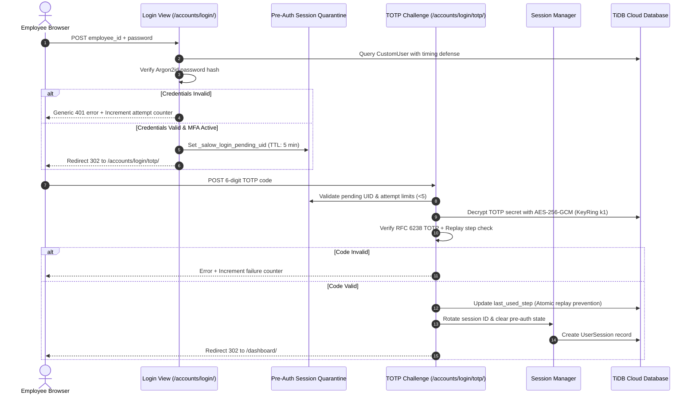

# Salow Workspace — Authentication Architecture & Protocols

**Authoritative Specification**: Salow Workspace IAM Architecture  
**Document Status**: Official Engineering Architecture Guide  
**Applies To**: `apps.accounts.views.login`, `apps.accounts.auth`, `apps.accounts.middleware`  

---

## 1. Authentication Principles

Salow Workspace implements a defense-in-depth authentication pipeline:
1. **Server-Side Django Sessions Only**: Browser sessions are managed entirely on the server using encrypted cookies (`sessionid`). JWT tokens, OAuth bearer tokens, and `/auth/token/` endpoints are strictly prohibited.
2. **Two-Factor Authentication by Default**: Normal authentication requires knowledge factor (Employee ID + Password) followed by possession factor (TOTP Authenticator or WebAuthn Passkey).
3. **No Direct Login via Password**: Verification of credentials alone **never** grants authenticated session privileges when MFA is active.
4. **Restricted Pre-Authentication Boundary**: Intermediate authentication states are quarantined within an isolated pre-auth state that cannot access protected views.



---

## 2. Step 1: Identifier & Password Verification

### 2.1 Route & Endpoint
- **URL**: `/accounts/login/`
- **Method**: `GET` (renders login form), `POST` (evaluates credentials).
- **Protection**: CSRF token required, IP and Employee ID rate limiting via `RateLimitMiddleware`.

### 2.2 User Enumeration & Timing Attack Defense
When an invalid `employee_id` is submitted:
```python
# Timing mitigation executes a dummy Argon2id calculation
dummy_hasher = Argon2PasswordHasher()
dummy_hasher.verify(password, DUMMY_HASH)
```
This ensures the response time for existing accounts matches non-existing accounts, thwarting timing-based user enumeration attacks.

---

## 3. Step 2: Restricted Pre-Authentication State

When password verification succeeds and the user requires MFA:
1. The user's primary database session key is **not** authenticated (`request.user.is_authenticated` remains `False`).
2. The user ID is stored in the restricted session dictionary:
   - `request.session['_salow_login_pending_uid'] = user.pk`
   - `request.session['_salow_preauth_timestamp'] = timezone.now().timestamp()`
   - `request.session['_salow_mfa_attempts'] = 0`
3. Expiry: The pre-authentication state expires strictly after **5 minutes** (300 seconds).
4. Failure Lockout: If 5 consecutive invalid TOTP submissions occur within pre-auth, the pending UID is purged and the user is redirected back to `/accounts/login/`.
5. Route Containment: Any attempt to access protected application endpoints (e.g., `/dashboard/`, `/attendance/`) results in an immediate 302 redirect back to `/accounts/login/`.

---

## 4. Step 3: MFA Challenge & Session Rotation

### 4.1 Challenge Interface
- **URL**: `/accounts/login/totp/`
- **Security Rule**: **Strictly NO QR code is rendered on the everyday challenge screen**. The QR code is displayed solely during first-time onboarding enrollment or administrator-authorized reset.
- **Input**: 6 numeric digits, formatted with autofocus and standard autocomplete attributes (`autocomplete="one-time-code"`).
- **Fallback**: Direct link to `/accounts/recovery/code/` for single-use recovery code authentication.

### 4.2 Atomic Replay Defense
To eliminate race conditions and replay attacks across clustered application workers:
```python
# Replay defense prevents same time-step reuse within the 30-second window
current_step = int(time.time() // 30)
if user.totp_device.last_used_step and current_step <= user.totp_device.last_used_step:
    raise AuthException("TOTP code already consumed for current time window.")
user.totp_device.last_used_step = current_step
user.totp_device.save(update_fields=["last_used_step"])
```

### 4.3 Session Finalization & Identifier Rotation
Upon successful TOTP validation:
1. `request.session.cycle_key()` is invoked to defend against session fixation attacks.
2. `django.contrib.auth.login(request, user)` marks the session as fully authenticated.
3. Pre-authentication keys (`_salow_login_pending_uid`, etc.) are purged.
4. Active session metadata (`IP`, `User-Agent`, `created_at`, `last_activity`) is stored in `apps.accounts.models.UserSession`.
5. The employee is redirected to `request.GET.get('next')` if valid, or `/dashboard/`.
