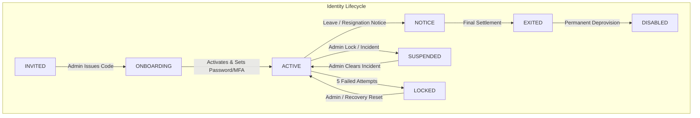

# Salow Workspace — Identity Architecture & Account Lifecycle

**Authoritative Specification**: Salow Workspace IAM Architecture  
**Document Status**: Official Engineering Architecture Guide  
**Applies To**: `apps.accounts`, `apps.directory`, `apps.core`  

---

## 1. Architectural Overview

Salow Workspace operates as an enterprise-grade Django modular monolith using **first-party identity and access management**. In accordance with core architectural directives:
- No external identity providers (Keycloak, Okta, Firebase Auth, Auth0) are permitted.
- The company Employee ID (`employee_id`) serves as the unique, immutable human-readable login identifier across all subsystems.
- All account state transitions are enforced server-side through transactional models and security middleware.

---

## 2. Account Identity Model (`CustomUser`)

The account identity is managed by `apps.accounts.models.CustomUser`, extending Django's `AbstractBaseUser` and `PermissionsMixin`.

### 2.1 Core Attributes
- **`employee_id`**: Normalized uppercase string (e.g., `ST-EMP-1001`, `ST-ADM-0001`). Indexed and unique. Immutable post-creation.
- **`email`**: Company email address (optional for activation, but standard for notifications).
- **`role`**: Enterprise RBAC role (`SUPER_ADMIN`, `ADMIN`, `HR`, `MANAGER`, `EMPLOYEE`, `INTERN`).
- **`status`**: Account lifecycle status (`INVITED`, `ONBOARDING`, `ACTIVE`, `INACTIVE`, `NOTICE`, `SUSPENDED`, `EXITED`, `LOCKED`, `DISABLED`).
- **`failed_login_attempts`**: Integer counter tracking consecutive password/MFA failures. Resets to 0 upon successful authenticated session creation.
- **`locked_until`**: Timestamp gating authentication when automated brute-force lock is triggered.
- **`mfa_enabled`**: Boolean flag requiring TOTP / Passkey verification.
- **`password_changed_at`**: Timestamp recording last credential rotation, used by session security middleware to invalidate stale sessions.

---

## 3. Account Provisioning & First-Time Activation

Salow Workspace completely eliminates email dependencies during account bootstrap. Activation relies on **one-time administrator-issued activation tokens**.

### 3.1 Crockford Base32 Token Specification
- **Format**: 10 characters split by a hyphen: `XXXXX-XXXXX` (e.g., `3K9JW-7MP2A`).
- **Alphabet**: Crockford's Base32 (`0123456789ABCDEFGHJKMNPQRSTVWXYZ`), strictly excluding ambiguous characters (`I, L, O, U`) to prevent manual transcription errors.
- **Storage**: The raw token is **never persisted**. The database stores only a keyed HMAC-SHA256 digest (`ActivationCode.code_hash`).
- **TTL**: 48 hours from issuance.
- **Attempt Limit**: Maximum 5 failed attempts per activation token before atomic lockout.
- **Consumption**: Atomic consumption occurs within database transaction boundaries with `select_for_update()` to prevent race conditions.

### 3.2 Activation Workflow
1. **Creation**: Administrator invokes `create_activation_code(user, purpose="ACTIVATION")`.
2. **Handoff**: The raw code is presented once to the issuing administrator and delivered out-of-band to the employee.
3. **Verification**: Employee navigates to `/accounts/activate/` and enters Employee ID and the 10-character code.
4. **Password Setup**: Employee inputs their permanent password satisfying enterprise complexity policies.
5. **MFA Enrollment**: An encrypted TOTP seed is provisioned, displaying an SVG QR code for authenticator apps.
6. **Recovery Key Generation**: 10 single-use emergency recovery codes are generated and displayed for safekeeping.
7. **Transition**: Upon successful completion, account status transitions from `ONBOARDING` to `ACTIVE`.

---

## 4. Account Lifecycle Governance & Security Enforcement

Account lifecycle states are strictly enforced at runtime by `AccountSecurityMiddleware` (`apps.accounts.middleware.AccountSecurityMiddleware`):

| Lifecycle Status | Interactive Sign-In | Active Session Validity | Automated Actions |
|---|---|---|---|
| `INVITED` | Denied (Redirected to activation) | N/A | None |
| `ONBOARDING` | Restricted to `/accounts/activate/*` | Terminated if navigating outside wizard | Complete onboarding wizard |
| `ACTIVE` | Allowed (Subject to Password + MFA) | Valid up to 15 min idle / 8 hr max | Standard workspace access |
| `INACTIVE` | Denied | Terminated immediately | None |
| `NOTICE` | Allowed | Valid | Audited operations |
| `SUSPENDED` | Denied | **Terminated immediately across all devices** | Immediate ejection to login with notice |
| `EXITED` | Denied | **Terminated immediately across all devices** | Permanent session purging |
| `LOCKED` | Denied (Until lockout window expires) | Terminated | Requires admin unlock or recovery flow |
| `DISABLED` | Denied | Terminated immediately | Permanent archive |

---

## 5. Security & Privacy Guarantees
1. **Timing Attack Invariance**: Employee ID lookup uses constant-time fake password hashing when non-existent accounts are queried, preventing username harvesting.
2. **Zero Plaintext Persistence**: Passwords, activation codes, recovery tokens, and TOTP seeds are never stored in plaintext or logged.
3. **Audit Trail**: Every state change triggers a structured `AuditEvent` in `apps.core.models.AuditEvent`.
