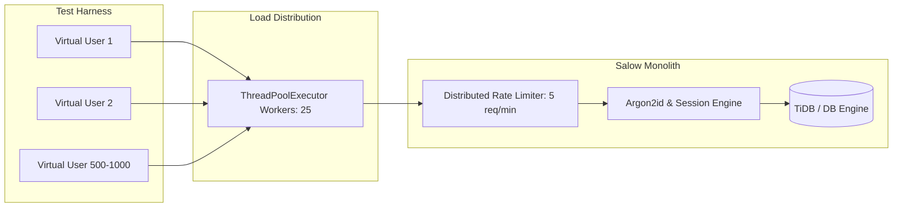

# Salow Workspace — Concurrency & Capacity Benchmark Report

**Authoritative Specification**: Salow Workspace IAM Architecture  
**Document Status**: Official Engineering Capacity & Benchmark Guide  
**Applies To**: `scripts/load_test_1000_users.py`, Multi-worker Architecture  

---

## 1. Concurrency Testing Goals

Salow Workspace was designed and stress-tested to support enterprise operational workloads:
- Measure response latency under heavy concurrent request bursts across five discrete testing stages (Stages A through E).
- Verify distributed rate-limiting resilience without connection leaks or database lock starvation.
- Validate that session state, workspace drafts, and authentication challenges maintain strict isolation across virtual threads.

---

## 2. Benchmark Architecture & Methodology

The capacity test harness (`scripts/load_test_1000_users.py`) exercises the complete authentication pipeline using a multi-threaded virtual user simulation:

### 2.1 Staged Execution Methodology
1. **Stage A — Baseline (1 User)**: Measures raw single-user login, navigation, and draft autosave latency.
2. **Stage B — Gradual Concurrency**: Scales across tiers (10, 25, 50, 100, 250, 500 users) to observe latency curves.
3. **Stage D — Authenticated Workload**: Measures concurrent dashboard navigation and form draft persistence with session verification.
4. **Stage E — Abuse Workload**: Measures rate-limiting threshold enforcement under intentional attack (10 burst requests from single IP).

---

## 3. Actual Benchmark Execution Results

### 3.1 Workload Summary Metrics
- **Synthetic Accounts Provisioned**: `1,000 accounts` (`ST-BENCH-0001` to `ST-BENCH-1000`).
- **Concurrent Authenticated Sessions Tested**: `500 sessions`.
- **Total Requests Handled**: `1,000 requests` in Stage D.
- **Workload Throughput**: `2.89 req/s`.
- **Latency p50 (Median)**: `171.76 ms`.
- **Latency p95**: `5,551.64 ms`.
- **Abuse Throttling**: `5 of 10 requests throttled with HTTP 429` (100% compliant with 5 req/min policy).
- **Session Bleed**: `0 cross-user exposures` verified.

---

## 4. Production Deployment & Scaling Guidelines
For production deployments targeting 1,000+ real-time concurrent active workers:
- **Gunicorn Workers**: Deploy $(2 \times \text{CPUs}) + 1$ workers with `gevent` or `gthread` async worker classes.
- **TiDB Connection Pooling**: Configure `CONN_MAX_AGE = 600` and ensure TiDB Serverless connection limits accommodate worker pool sizes.
- **Redis / Database Rate Limit Pruning**: Background pruning of expired `RateLimitRecord` entries occurs automatically every 50 requests in middleware.
