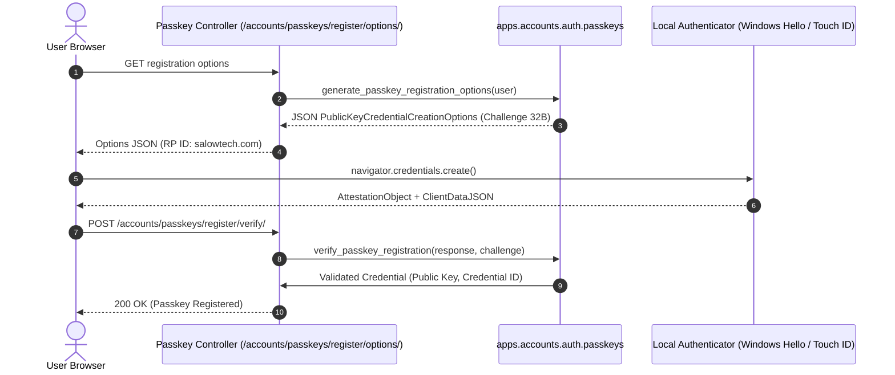

# Salow Workspace — Multi-Factor Authentication & WebAuthn Passkeys

**Authoritative Specification**: Salow Workspace IAM Architecture  
**Document Status**: Official Engineering Architecture Guide  
**Applies To**: `apps.accounts.auth.mfa_totp`, `apps.accounts.auth.passkeys`, `apps.accounts.models`  

---

## 1. Multi-Factor Authentication Architecture

Salow Workspace requires two-factor authentication across all organizational tiers (Employees, Interns, Managers, HR, Admins, Super Admins).
Two primary possession-factor technologies are supported:
1. **Time-Based One-Time Passwords (TOTP)** — RFC 6238 standard.
2. **WebAuthn / FIDO2 Passkeys** — W3C Recommendation (Level 3 asymmetric cryptography).

---

## 2. TOTP Implementation (RFC 6238)

### 2.1 Cryptographic Storage: AES-256-GCM KeyRing
TOTP secret keys represent sensitive persistent authenticators. In Salow Workspace, TOTP secrets are **never stored in plaintext**:
- **Algorithm**: AES-256-GCM (Authenticated Encryption with Associated Data).
- **Key Ring**: Multi-version key ring (`KeyRing`) managed in `apps.accounts.auth.crypto`. Current default key ID is `k1`.
- **Nonce/IV**: 12 bytes of unique entropy generated via `os.urandom(12)` per encryption operation.
- **Ciphertext Structure**: Stored as base64-encoded payload containing:
  $$\text{Payload} = \text{key\_id (4B)} \parallel \text{nonce (12B)} \parallel \text{ciphertext} \parallel \text{GCM tag (16B)}$$
- **Decryption Failures**: Fail closed immediately. Corrupted tags or tampered ciphertexts raise `DecryptionError`.

### 2.2 QR Code Generation
- Generated purely in Python using SVG vector graphics (`apps.accounts.auth.mfa_totp.generate_totp_svg_qr()`).
- Eliminates external web requests or dependencies on third-party QR generation APIs (e.g. Google Charts API).
- Provisioning URI conforms to: `otpauth://totp/Salow%20Workspace:{employee_id}?secret={secret}&issuer=Salow%20Technologies&algorithm=SHA1&digits=6&period=30`.

### 2.3 Clock Drift & Replay Protections
- **Time Step**: 30 seconds.
- **Clock Drift Tolerance**: $\pm 1$ step (30 seconds before and after), accommodating unsynchronized mobile devices.
- **Replay Enforcement**: Persistent `last_used_step` field on `TOTPDevice` prevents replay attacks during the active 30-second window.

---

## 3. WebAuthn Passkeys (FIDO2 / W3C Level 3)

Passkeys provide phishing-resistant authentication using asymmetric public-key cryptography.

### 3.1 Model Definition (`PasskeyCredential`)
- `user`: Foreign key to `CustomUser`.
- `credential_id`: Unique binary identifier generated by the authenticator (indexed).
- `public_key`: COSE-encoded public key (e.g. ES256, RS256).
- `sign_count`: Monotonically increasing signature counter used for cloned authenticator detection.
- `aaguid`: Authenticator Attestation GUID.
- `device_type`: Platform (e.g. Windows Hello, Touch ID) or Cross-Platform (hardware security key).
- `name`: User-friendly label (e.g., "Work Laptop Windows Hello", "YubiKey 5C").

### 3.2 Registration Ceremony

### 3.3 Verification & Phishing Resistance
- **Origin Validation**: Strict verification of `clientDataJSON.origin` matching the configured production or local domain.
- **RP ID**: Bound to the Salow Workspace domain (`RP_ID`), preventing passkeys registered on `salowtech.com` from being replayed on phishing clones.
- **User Verification**: Set to `preferred` or `required` to trigger local biometric verification (fingerprint, facial recognition, or hardware PIN).
- **Revocation**: Users can revoke individual passkeys at `/accounts/security/passkeys/` after re-authenticating with their current password.
