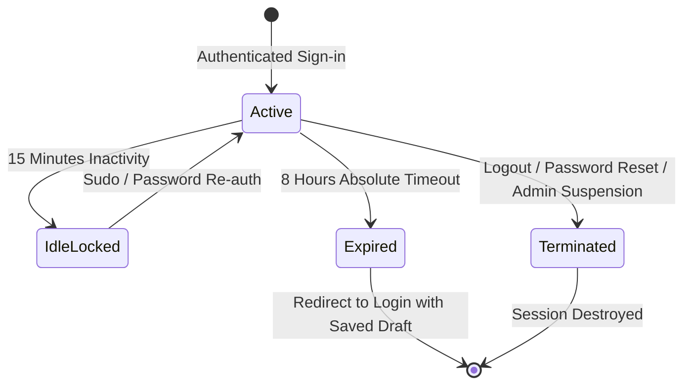

# Salow Workspace — Session Security, Device Management & Draft Preservation

**Authoritative Specification**: Salow Workspace IAM Architecture  
**Document Status**: Official Engineering Architecture Guide  
**Applies To**: `apps.accounts.middleware`, `apps.accounts.models.UserSession`, `apps.accounts.models.WorkspaceDraft`  

---

## 1. Server-Side Session Foundations

Salow Workspace uses Django's secure database-backed session engine (`django.contrib.sessions.backends.db.SessionStore`) combined with hardened cookie attributes:
- **`SESSION_COOKIE_HTTPONLY = True`**: Prevents JavaScript (XSS payloads) from accessing the session cookie.
- **`SESSION_COOKIE_SECURE = True`**: Guarantees the session cookie is transmitted solely over TLS (HTTPS).
- **`SESSION_COOKIE_SAMESITE = 'Lax'`**: Protects against Cross-Site Request Forgery (CSRF) on external navigation.
- **Session Rotation (`cycle_key`)**: Invoked on successful login, password change, and privilege escalation to defeat session fixation attacks.

---

## 2. Session Lifecycle & Timeout Policy

### 2.1 Configured Timeout Boundaries
- **Idle Timeout**: **15 minutes** (900 seconds). Evaluated on every incoming request by `AccountSecurityMiddleware`.
- **Absolute Session Lifetime**: **8 hours** (28,800 seconds). After 8 hours from creation, the session is forcibly retired regardless of recent activity.
- **Immediate Ejection**: When an employee's account status transitions to `SUSPENDED` or `EXITED`, all corresponding sessions are revoked in real-time across all connected devices.

---

## 3. Server-Side Workspace Draft Preservation

To prevent accidental data loss when an employee's session locks while working on long-form content (e.g. daily logs, performance reports, attendance remarks):

### 3.1 Model Specification (`WorkspaceDraft`)
- `user`: Foreign key to `CustomUser`.
- `form_id`: Form or page identifier (e.g., `daily_log_form`, `post_editor`).
- `draft_data`: Encrypted JSON field preserving unfinished form fields.
- `return_url`: Validated internal path (e.g., `/posts/create/`).
- `expires_at`: TTL of 24 hours.

### 3.2 Draft Lock & Resumption Flow
1. **Detection**: Middleware detects idle timeout exceeding 15 minutes.
2. **Draft Snapshot**: Before terminating the active session, any pending POST payload or autosaved state is serialized into `WorkspaceDraft`.
3. **Redirection**: Browser is redirected to `/accounts/security/idle-lock/?next={return_url}`.
4. **Resumption**: The employee provides their password or passkey.
5. **Restoration**: Upon re-authentication, the user is redirected back to `return_url`, and the draft content is injected back into the form fields.

---

## 4. Multi-Device Management (`UserSession`)

Employees can inspect and manage active sessions from `/accounts/security/sessions/`:
- **Active Devices List**: Displays device type (Desktop, Mobile, Tablet), browser family, client IP, login time, and last activity time.
- **Revoke Other Sessions**: Allows an employee to terminate all other active logins with a single click (`revoke_user_sessions(user, keep_session_key=current_key)`).
- **Administrative Revocation**: Super Admins and HR can invalidate any employee's sessions during an account compromise or deprovisioning event.

---

## 5. Second-Device Authorization Workflow (`DeviceApprovalRequest`)

When a user with an active session attempts to sign in from an unrecognized device or IP/User-Agent fingerprint, the secondary device workflow is triggered:
1. **60-Second Ephemeral Expiration**: An approval request is recorded with a strict 60-second validity window.
2. **Primary Device Approval**: The primary active device receives an in-app prompt to approve or reject the request.
3. **Administrative Fallback**: If the primary device is unavailable or lost, an Administrator (or dual-control for Super Admin) can approve the request with an audited justification.
4. **Company Email OTP**: An out-of-band numeric 6-digit OTP is dispatched to the employee's official company email.
5. **Facial Biometric Verification**: The employee performs a 1:1 facial biometric verification against their enrolled reference template before the session is created.
6. **Independent Session Binding**: Once approved and verified, a distinct server-side session is created and bound to the new device.

